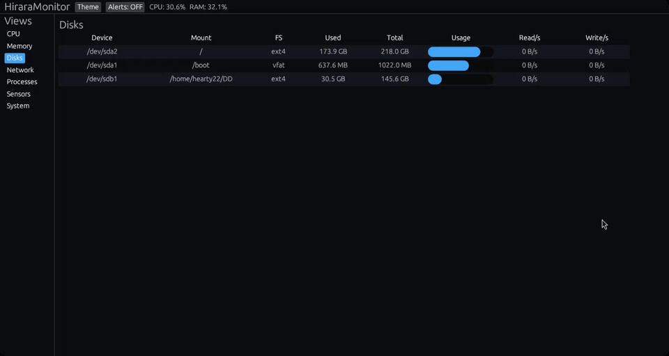
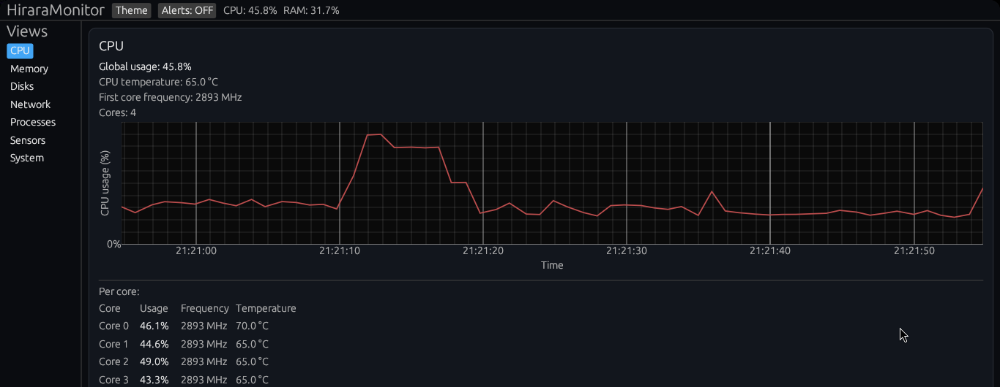
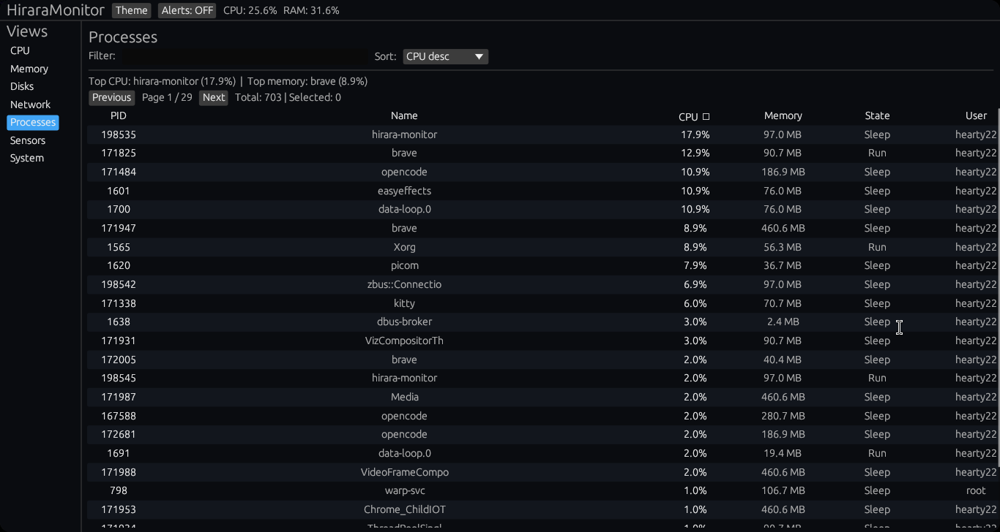
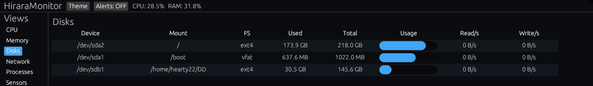

# HiraraMonitor



[](https://github.com/hearty22/HiraraMonitor/releases)
[](https://github.com/hearty22/HiraraMonitor/actions/workflows/ci.yml)
[](LICENSE)
[](https://www.rust-lang.org)

A native Linux system monitor with a GUI, built in Rust with [egui](https://github.com/emilk/egui).
Real-time CPU, memory, disk, network, process and sensor views, plus an optional system tray, without leaving the desktop.

## Why I built it

`btop` is excellent, but it lives in a terminal. I wanted the same information in a native window I can keep on a second monitor, with a tray icon I can restore from, and I wanted to learn how far egui could go for a real, stateful desktop app.

The interesting part was not the charts, it was keeping the UI at a stable frame rate while a separate thread reads `/proc` and `sysinfo` every few hundred milliseconds.

## Features

- **CPU**: global and per-core usage, current frequency, temperature when available, rolling chart.
- **Memory**: RAM and swap usage with history charts.
- **Disks**: usage, filesystem, mount point, plus read/write throughput from `/proc/diskstats`.
- **Network**: per-interface RX/TX rates and totals.
- **Processes**: filter, sorting, pagination, multi-selection, detail window, guarded terminate and kill.
- **Sensors**: component temperatures with current and maximum values.
- **System**: hostname, OS, kernel, architecture, uptime and load average.
- **Extras**: light/dark themes, configurable visual alerts, TOML preferences, optional system tray.

## Screenshots

| CPU | Processes |
|---|---|
|  |  |

| Disks |
|---|
|  |

## Install

Prebuilt Linux binaries are published on the [releases page](https://github.com/hearty22/HiraraMonitor/releases).

```bash
curl -fsSL https://raw.githubusercontent.com/hearty22/HiraraMonitor/main/install.sh | sh
```

This downloads the latest `x86_64-linux` binary into `~/.local/bin`. Make sure that directory is on your `PATH`.

Runtime dependencies for the tray (Arch):

```bash
sudo pacman -S gtk3 libappindicator-gtk3
```

The app runs without the tray if those libraries are missing, but you will see a warning in the logs.

### From source

```bash
git clone https://github.com/hearty22/HiraraMonitor.git
cd HiraraMonitor
cargo build --release
./target/release/hirara-monitor
```

Requires a recent stable Rust toolchain and X11. Build without the tray with `--no-default-features`.

## Usage

```bash
hirara-monitor --refresh-ms 500 --history 300 --dark
```

| Flag | Description |
|---|---|
| `--refresh-ms <ms>` | Metric refresh interval, minimum 250 ms |
| `--history <samples>` | Retained samples for charts, clamped to 30..5000 |
| `--light` / `--dark` | Start with a specific theme |
| `--config <path>` | Config file path, overrides `HIRARA_CONFIG` |

Configuration is persisted to `~/.config/hiraramonitor/config.toml` by default.

### Keyboard shortcuts

| Key | Action |
|---|---|
| `1`–`7` | Switch view |
| `T` | Toggle theme |

Process rows support single and multi-select (Ctrl/Shift). Terminate and force-kill actions ask for confirmation, and PID 1 plus the monitor's own process are protected.

## Architecture

The app separates collection from rendering:

```text
sysinfo + /proc
      │
      ▼
Collector thread ──► Arc<SystemSnapshot> ──► sync_channel(1)
                                                  │
                                                  ▼
                                          App state + history
                                                  │
                                                  ▼
                                             egui panels
```

- `metrics/collector.rs` refreshes system information on a background thread with backoff on failure.
- `metrics/snapshot.rs` defines immutable snapshots shared through `Arc`.
- `metrics/history.rs` keeps fixed-capacity circular buffers for charts.
- `ui/` renders each view from the latest snapshot without blocking the render loop.
- `platform/` isolates Linux-specific code such as disk throughput.

See [docs/ARCHITECTURE.md](docs/ARCHITECTURE.md) for the full breakdown.

## Engineering notes

- Collector and render loop communicate through a bounded channel, so a slow UI never queues unbounded snapshots.
- Process actions send signals through a small platform layer and report per-PID results.
- The system tray has AppIndicator and KSNI backends, which makes it work on desktops and bars like Polybar.
- CI runs `cargo fmt --check`, `cargo clippy -D warnings` and `cargo test` on every pull request; tags publish release binaries automatically.

## Limitations

- Linux only. Other targets compile with fallback disk metrics.
- GPU monitoring is intentionally out of scope.
- Sensor availability depends on what `sysinfo` exposes on your hardware.
- The UI is read-only except for guarded process signals.

## License

MIT
